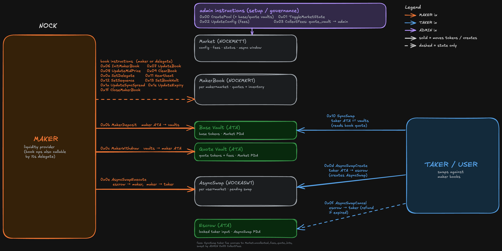

# nock

per-maker on-chain order book exchange on solana.

## Architecture



## Layout

```
interface/   state structs, errors, ix payload schemas, constants
program/     entrypoint + per-ix processors
tests/       pure-Rust unit tests: layouts, offsets, tags, pricing math
```

## Instructions

| Disc | Name                | Actor          | Notes                                      |
|------|---------------------|----------------|--------------------------------------------|
| 0x00 | CreatePool          | admin          | Inits market PDA + 2 vault ATAs            |
| 0x01 | ToggleMarketState   | admin          | Admin: pause / unpause                     |
| 0x02 | UpdateConfig        | admin          | Admin: set maker_fee_ppm / taker_fee_ppm   |
| 0x03 | CollectFees         | admin          | Admin sweeps accrued quote fees to an ATA  |
| 0x06 | InitMakerBook       | maker          | Permissionless: anyone allocates a book    |
| 0x07 | UpdateBook          | maker/delegate | Replace mid + 16 bid + 16 ask levels       |
| 0x08 | UpdateMidPrice      | maker/delegate | Mid-only refresh (fast path)               |
| 0x09 | ClearBook           | maker/delegate | Wipe all 32 levels                         |
| 0x0a | SetBookDelegate     | maker          | Maker authorizes a delegate signer         |
| 0x0b | MakerDeposit        | maker          | Deposit base + quote in one ix             |
| 0x0c | MakerWithdraw       | maker          | Withdraw base + quote in one ix            |
| 0x0d | AsyncSwapCreate     | user           | User locks input tokens in escrow PDA      |
| 0x0e | AsyncSwapExecute    | maker          | Maker fills the pending swap               |
| 0x0f | AsyncSwapCancel     | anyone         | Refunds an expired async swap              |
| 0x10 | SyncSwap            | user           | Swap against a book: side 0 sells base, side 1 buys base |
| 0x11 | MakerHeartbeat      | maker/delegate | Bump sequence + stamp on-chain slot        |
| 0x12 | MakerSetSequence    | maker/delegate | Bump sequence only                         |
| 0x13 | SetBookHalt         | maker/delegate | Instant kill switch: halt/resume all quotes (1-byte write) |
| 0x1a | UpdateSyncSpread    | maker/delegate | Adjust per-book spread (in ticks)          |
| 0x1e | UpdateExpiryInSlots | maker/delegate | Adjust quote-expiry window                 |
| 0x1f | CloseMakerBook      | maker          | Maker reclaims rent and closes book        |

## Program size

| What                  | Bytes      |
|-----------------------|-----------:|
| `nock.so`             |  75,712    |

## Account types

| Tag       | Size | What                                  |
|-----------|------|---------------------------------------|
| NOCKMKT1  | 272  | Market (per market: mints, vaults, fees, async-delay window) |
| NOCKMKR1  | 776  | MakerBook (per maker × market: 16 bids, 16 asks, mid, inventory) |
| NOCKASW1  | 168  | AsyncSwap (pending swap request)      |

## Build & deploy

```
cargo build-sbf --manifest-path program/Cargo.toml
solana program deploy --url http://127.0.0.1:8899 \
  --program-id target/deploy/nock-keypair.json \
  target/deploy/nock.so
```

## Program ID

```
7VAMrYiGYS8orio29rF5U4WPaNRz8ymBEtoTbwNjJg2z
```
